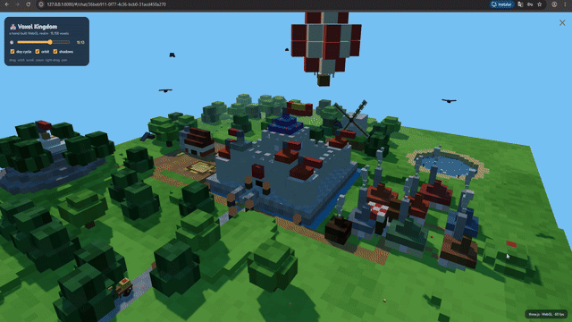
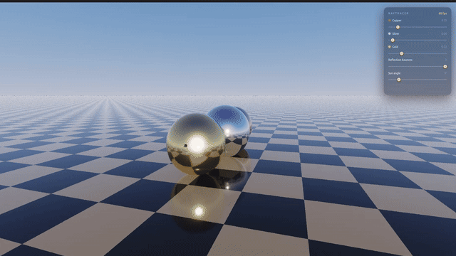
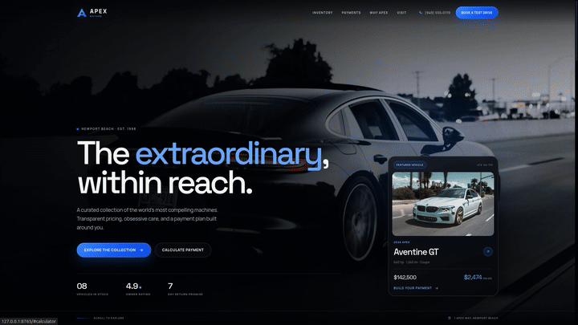
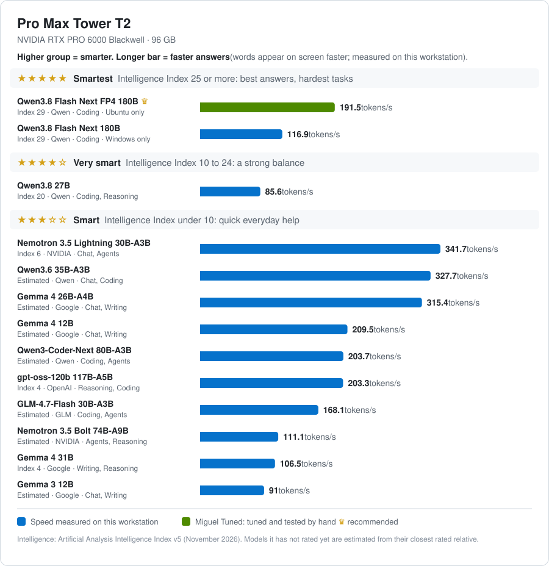
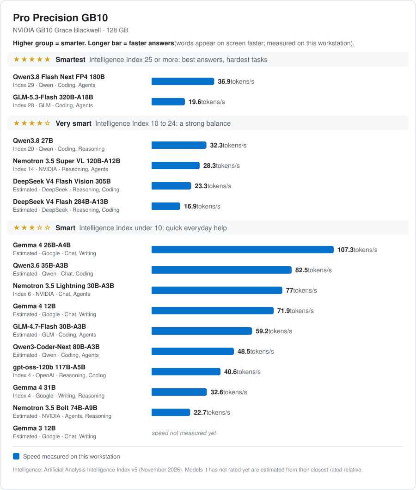
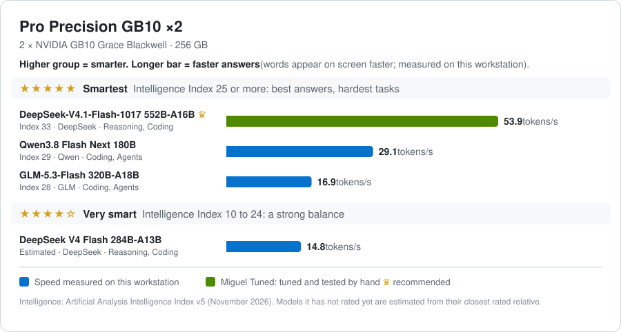

# Ambassador Local: private, one-click local AI on Dell Pro Max and Dell Pro Precision GB10

**Ambassador Local** is a one-click app that recognises your Dell Pro Max Tower T2 or Dell Pro Precision GB10, shows
only the AI models tested on that exact machine, and starts the one you pick on its NVIDIA GPU. You get a private,
OpenAI-compatible endpoint protected by an API key, with no cloud and no telemetry. You stay in charge: you choose the
model, when it runs, and whether other devices on your network may reach it.

## Watch it first

The overview video is attached to this repository's [Releases](../../releases).

## How it works

| Stage | What happens | Check or human gate |
|---|---|---|
| 1. Install | A one-line PowerShell or shell command downloads the latest signed installer from the original project's official Releases and installs it (Windows: for your user, no admin; Linux: with `apt`). | The installer's SHA256 must match the one GitHub publishes for that file, or nothing is installed. On Linux, `apt` asks for your password. |
| 2. Detect | The app reads the GPU with `nvidia-smi` and recognises the workstation. | Only the workstation detected on the machine can be used; systems not tested yet show as *Coming soon*. |
| 3. Pick | **System → Workstation → Lab → Model.** Every model shows the speed measured on that workstation; **Miguel Tuned** marks recipes tuned and tested by hand, a crown marks the recommended one. | You pick the model. Only recipes tested on your workstation are offered. |
| 4. Run | The app downloads what the model needs, loads it on the GPU and shows **Live**. | Every file is checked against the SHA256 in the catalog and deleted if it doesn't match. Container recipes (vLLM, TensorFold) first check Docker, the pinned image, complete weights and a free GPU (on both units for two GB10). |
| 5. Use | **Open chat**, or paste the endpoint URL and API key into any OpenAI-compatible app (Hermes, OpenCode and other coding agents). | Every request needs the API key. You choose whether the server listens on 127.0.0.1 only or on your local network. |
| 6. Stop or update | **Stop server**, close the app, or uninstall from the sidebar. The app can offer a newer release from the original project's official Releases. | Updates install only when you click **Update** and confirm, and only if the package is signed with the key built into the app. |

Real results, each from a single prompt, recorded on the systems named:

| Voxel kingdom · Qwen3.8 27B · Dell Pro Max Tower T2 (Windows) | Ray tracer in 1:59 · Qwen3.8 Flash Next FP4 · Dell Pro Max Tower T2 (Ubuntu) | Dealership site · DeepSeek-V4.1 · two Dell Pro Precision GB10 |
|---|---|---|
|  |  |  |

## Hardware

**Built and run on**

| Component | Built and run on |
|---|---|
| System | Dell Pro Max Tower T2; Dell Pro Precision GB10 (one, and two linked over ConnectX-7) |
| GPU (with memory) | NVIDIA RTX PRO 6000 Blackwell Workstation Edition (T2); NVIDIA GB10 Grace Blackwell superchip (GB10). Memory: 96 GB GDDR7 (T2); 128 GB unified LPDDR5x (GB10) |
| CPU | Intel Core Ultra 9 285K (T2); the GB10 superchip's Grace CPU (GB10) |
| Memory | 128 GB DDR5 (T2); 128 GB unified LPDDR5x (GB10) |
| Storage | 4 TB Gen5 SSD (T2); 4 TB SSD (GB10) |
| OS | Windows 11 Pro or Ubuntu 24.04 (T2); NVIDIA DGX OS 7 (GB10) |
| Software | Ambassador Local (llama.cpp) |

### Which model should I pick?

Models are grouped by how smart they are, from the smartest at the top, using an external ranking:
[Artificial Analysis Intelligence Index](https://artificialanalysis.ai/leaderboards/models) v5, November 2026; not Dell
testing. Models it has not rated yet are estimated from their closest rated relative: Nemotron 3.5 Bolt,
Qwen3.6 35B-A3B, Qwen3-Coder-Next, Gemma 4 26B-A4B, Gemma 4 12B, GLM-4.7-Flash, DeepSeek V4 Flash,
DeepSeek V4 Flash Vision and Gemma 3 12B (marked *Estimated* in the charts). Each bar shows how fast the model answers on that system
(measured there, in tokens per second: a token is about ¾ of a word). **Pick the highest group that still feels fast
enough for you.** For chat, anything above about 20 tokens/s already writes faster than you can read; for coding
agents, faster is better.

<picture>
  <source media="(prefers-color-scheme: dark)" srcset="docs/img/pick-pro-max-t2-dark.svg">
  
</picture>

<picture>
  <source media="(prefers-color-scheme: dark)" srcset="docs/img/pick-pro-max-gb10-dark.svg">
  
</picture>

<picture>
  <source media="(prefers-color-scheme: dark)" srcset="docs/img/pick-pro-max-gb10-x2-dark.svg">
  
</picture>

### Tested on

Each recipe is tuned and measured on the system in its column: the average speed measured there and the disk space
its weights need. A model only appears in the app on the systems marked here. For example, Qwen3.8 Flash Next FP4
runs at 191.5 tokens/s on the Dell Pro Max Tower T2 (Ubuntu), and DeepSeek-V4.1-Flash-1017 (552B) runs across two
linked Dell Pro Precision GB10 at 53.9 tokens/s.

<!-- models:start -->
| Model | Dell Pro Max Tower T2 | Dell Pro Precision GB10 | Two Dell Pro Precision GB10 |
| --- | --- | --- | --- |
| NVIDIA · **Nemotron 3.5 Super VL** 120B-A12B | — | ✓ 28.3 tok/s · 87 GB | — |
| NVIDIA · **Nemotron 3.5 Bolt** 74B-A9B | ✓ 111.1 tok/s · 79 GB | ✓ 22.7 tok/s · 50 GB | — |
| NVIDIA · **Nemotron 3.5 Lightning** 30B-A3B | ✓ 341.7 tok/s · 39 GB | ✓ 77 tok/s · 26 GB | — |
| Qwen · **Qwen3.8 Flash Next** 180B | ✓ 116.9 tok/s · 94 GB · Windows only | — | ✓ 29.1 tok/s · 114 GB |
| Qwen · **Qwen3.6 35B-A3B** | ✓ 327.7 tok/s · 39 GB | ✓ 82.5 tok/s · 23 GB | — |
| Qwen · **Qwen3.8 27B** | ✓ 85.6 tok/s · 31 GB | ✓ 32.3 tok/s · 19 GB | — |
| Qwen · **Qwen3-Coder-Next** 80B-A3B | ✓ 203.7 tok/s · 86 GB | ✓ 48.5 tok/s · 50 GB | — |
| Google · **Gemma 4 31B** | ✓ 106.5 tok/s · 36 GB | ✓ 32.6 tok/s · 18 GB | — |
| Google · **Gemma 4 26B-A4B** | ✓ 315.4 tok/s · 28 GB | ✓ 107.3 tok/s · 15 GB | — |
| Google · **Gemma 4 12B** | ✓ 209.5 tok/s · 14 GB | ✓ 71.9 tok/s · 7 GB | — |
| GLM · **GLM-4.7-Flash** 30B-A3B | ✓ 168.1 tok/s · 36 GB | ✓ 59.2 tok/s · 18 GB | — |
| GLM · **GLM-5.3-Flash** 320B-A18B | — | ✓ 19.6 tok/s · 88 GB | ✓ 16.9 tok/s · 157 GB |
| DeepSeek · **DeepSeek V4 Flash** 284B-A13B | — | ✓ 16.9 tok/s · 104 GB | ✓ 14.8 tok/s · 155 GB |
| DeepSeek · **DeepSeek V4 Flash Vision** 305B | — | ✓ 23.3 tok/s · 116 GB | — |
| OpenAI · **gpt-oss-120b** 117B-A5B | ✓ 203.3 tok/s · 65 GB | ✓ 40.6 tok/s · 65 GB | — |
| Google · **Gemma 3 12B** | ✓ 91 tok/s · 14 GB | ✓ · 7 GB | — |
| Qwen · **Qwen3.8 Flash Next FP4** 180B | ✓ 191.5 tok/s · 102 GB · Ubuntu only · Miguel Tuned | ✓ 36.9 tok/s · 102 GB | — |
| DeepSeek · **DeepSeek-V4.1-Flash-1017** 552B-A16B | — | — | ✓ 53.9 tok/s · 211 GB · Miguel Tuned |
<!-- models:end -->

## What's in this repo

| Path | What |
|---|---|
| `install.ps1`, `install.sh` | One-line installers for Windows and Linux; they download the latest signed release from the original project ([MangelZabalaDevelop/ambassador-local](https://github.com/MangelZabalaDevelop/ambassador-local/releases)) and check its SHA256 |
| `src/` | The app's interface (React, TypeScript): model table, run screen, specs, update and uninstall dialogs, lab logos |
| `src-tauri/` | The app's core (Rust, Tauri): workstation detection, downloads, llama.cpp, vLLM and TensorFold engines, the two-GB10 cluster check, chat proxy, updater, uninstall, and the catalog tests |
| `src-tauri/llama-ui/` | llama.cpp's chat page, served for the container recipes (MIT, its own `LICENSE`) |
| `recipes/catalog.json`, `recipes/catalog.schema.json` | Every workstation, model and recipe the app offers, pinned by URL, SHA256 and size, and the schema that checks them |
| `recipes/vllm/`, `recipes/tensorfold/` | The container recipes (Miguel Tuned and others), each with its `README.md`, `config.sh`, `run.sh` and `stop.sh` |
| `scripts/` | Catalog tools: the README model table and charts, the updater's `latest.json`, and the llama.cpp chat page copy |
| `public/hardware/` | Product photos of the workstations shown in the app |
| `docs/img/` | Model charts per system and sample outputs |
| `docs/CHECKLIST.md` | The full setup, run and reset checklist, with security notes |
| `docs/DEVELOPING.md` | Adding recipes, building from source and publishing a release |
| `LICENSE`, `THIRD_PARTY_NOTICES.md` | MIT licence and every upstream notice |

## Setup

1. Check your system against [Hardware](#hardware): a Dell Pro Max Tower T2 (Windows 11 Pro or Ubuntu 24.04) or a
   Dell Pro Precision GB10 (DGX OS), with the NVIDIA driver working (`nvidia-smi` shows the GPU).
2. Install. **Windows:** open PowerShell and paste

   ```powershell
   irm https://raw.githubusercontent.com/MangelZabalaDevelop/ambassador-local/main/install.ps1 | iex
   ```

   **Linux** (Dell Pro Max Tower T2 with Ubuntu, Dell Pro Precision GB10 with DGX OS): open a terminal and paste

   ```bash
   curl -fsSL https://raw.githubusercontent.com/MangelZabalaDevelop/ambassador-local/main/install.sh | bash
   ```

   The installers come from the original author's official, signed releases (the same scripts are in this repo as
   `install.ps1` and `install.sh`). Each checks the download's SHA256 before installing.
3. Open **Ambassador Local** from the Start menu or the app menu.
4. Pick a model (**System → Workstation → Lab → Model**) and press **Run**. Wait for **Live**.
5. Press **Open chat**, or copy the **Endpoint URL** and **API key** from *Connect apps* into your OpenAI-compatible
   app.
6. For the container recipes (vLLM, TensorFold) and for two linked GB10, set up Docker with the NVIDIA runtime, the
   pinned images and weights, and the NVIDIA Sync cluster setup first, as each recipe's `README.md` in `recipes/`
   describes.
7. The full checklist (prerequisites, install checks, connecting apps, stop, reset and uninstall, security) is in
   [`docs/CHECKLIST.md`](docs/CHECKLIST.md). Building from source and publishing a release are in
   [`docs/DEVELOPING.md`](docs/DEVELOPING.md).

## Known limits

- **Dell Pro Max 18 Plus and Dell Pro Max 16 Premium:** coming soon in the app, with no tested recipes yet. Today's tested recipes run on the Dell Pro Max Tower T2 with the 96 GB RTX PRO 6000 Blackwell and on the Dell Pro Precision GB10 with 128 GB of unified memory, one unit or two linked; Tested on shows which model runs on which.
- Every recipe runs only on the system it was tested on. Some are tied to one OS: Qwen3.8 Flash Next (llama.cpp) on
  the Dell Pro Max Tower T2 is Windows only, Qwen3.8 Flash Next FP4 on the T2 is Ubuntu only, and the vLLM and
  TensorFold recipes run on Linux only. Dell Pro Precision GB10 runs Linux (DGX OS) only.
- Gemma 3 12B on one Dell Pro Precision GB10 has no measured speed yet.
- The container recipes need Docker with the NVIDIA runtime, and their images and weights are large (see the
  [Tested on](#tested-on) disk column). Several download their engine or serving source from third-party repositories
  (pinned by commit or digest) on first build or start; those are not bundled here (see `THIRD_PARTY_NOTICES.md`).
- The two-GB10 recipes need the direct ConnectX cable and the cluster setup from NVIDIA Sync; the app does not set up
  the cluster.
- The GLM-5.3-Flash recipe uses a helper model whose licence allows **noncommercial use only** (CC BY-NC-ND 4.0). Read
  it before you use that recipe.
- The DeepSeek V4 Flash Vision model used by its recipe has had its refusals removed by its authors.
- Speeds are the averages measured on the system named in each column; other configurations may differ.
- Dell does not build or sign the installers. The installers and the app's update check use the original author's
  official releases at [MangelZabalaDevelop/ambassador-local](https://github.com/MangelZabalaDevelop/ambassador-local/releases),
  and the app accepts only packages signed with the key built into it.

## Credits

- **Original author:** Ambassador Local was created by **Miguel Zabala, Dell Pro Precision Ambassador**. The original
  project is [MangelZabalaDevelop/ambassador-local](https://github.com/MangelZabalaDevelop/ambassador-local): please
  star it. **Miguel Tuned** is his label for recipes he tuned and tested by hand, kept as the product's own name.
- **Silicon partner:** NVIDIA. The models run on NVIDIA RTX PRO Blackwell GPUs and the NVIDIA GB10 Grace Blackwell
  superchip.
- **This copy:** Dell Technologies' copy of the upstream project, with the README, checklist, overview video and
  credits. The installers, the release links and the app's update check stay on Miguel Zabala's official signed
  releases at [MangelZabalaDevelop/ambassador-local](https://github.com/MangelZabalaDevelop/ambassador-local/releases);
  Dell builds and signs no installers. No other repository is bundled.
- **Upstream licences:** Ambassador Local is MIT (Copyright (c) 2026 Miguel Zabala). The llama.cpp chat page in
  `src-tauri/llama-ui/` is MIT (Copyright (c) 2023-2026 The ggml authors). Lab logos are from
  [Lobe Icons](https://github.com/lobehub/lobe-icons) (MIT). Models, engines and images downloaded at run time keep
  their own licences. All notices are in [`THIRD_PARTY_NOTICES.md`](THIRD_PARTY_NOTICES.md).
- **AI-generated assets:** the overview video in Releases was built with AI from the app's own screen images, Dell
  product photos and text, and is narrated by an AI voice.
- **Trademarks:** NVIDIA, RTX, Grace Blackwell, DGX OS, ConnectX and Nemotron are trademarks of NVIDIA Corporation.
  Intel and Core Ultra are trademarks of Intel Corporation. Qwen, Gemma, DeepSeek, GLM, gpt-oss, OpenAI, Hermes,
  OpenCode, Artificial Analysis and the lab logos are names and marks of their respective owners. Dell, Dell Pro Max
  and Dell Pro Precision are trademarks of Dell Inc. or its subsidiaries. Other names are trademarks of their
  respective owners.
- **Non-endorsement:** naming a third party's product, model or service does not mean that third party endorses this
  repository or Dell Technologies.

## Support

Logan Lawler, Dell Technologies: [logan.lawler@dell.com](mailto:logan.lawler@dell.com)

## License

MIT, see [`LICENSE`](LICENSE). The upstream copyright notice (Copyright (c) 2026 Miguel Zabala) is kept, and
"Copyright (c) 2026 Dell Inc. (changes by Dell Technologies)" covers Dell's changes. Third-party notices are in
[`THIRD_PARTY_NOTICES.md`](THIRD_PARTY_NOTICES.md).
